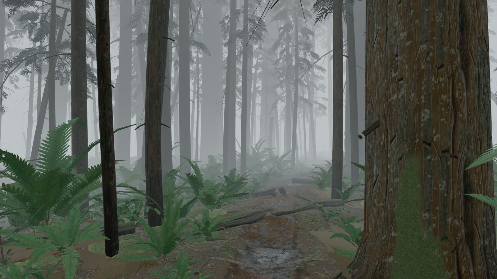
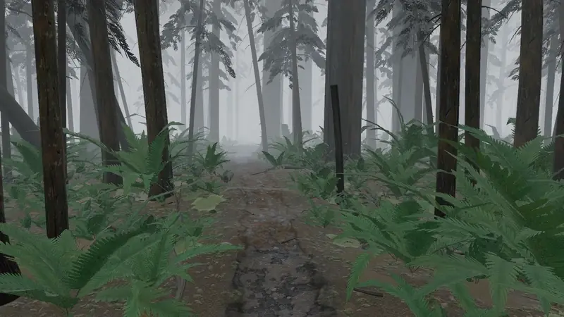
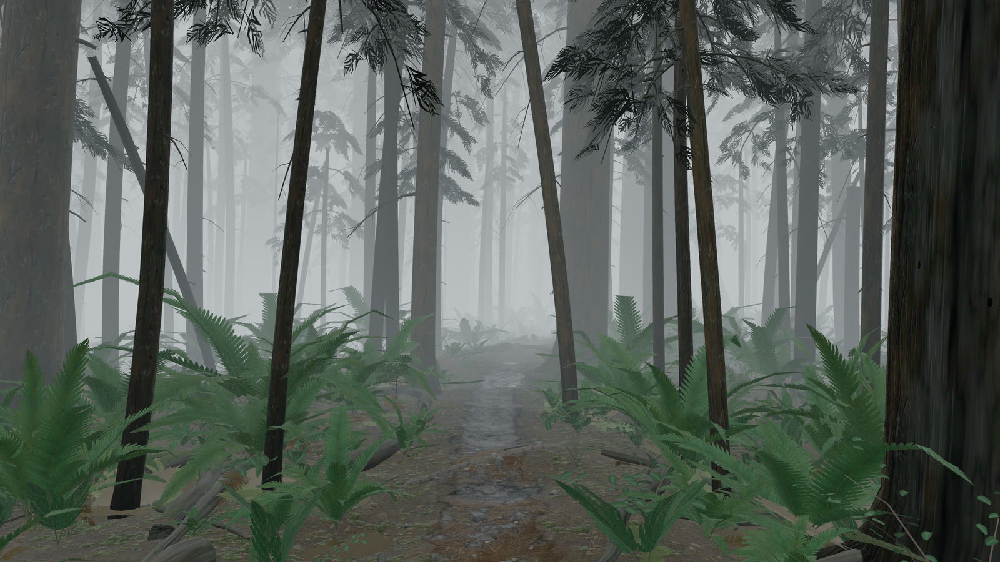
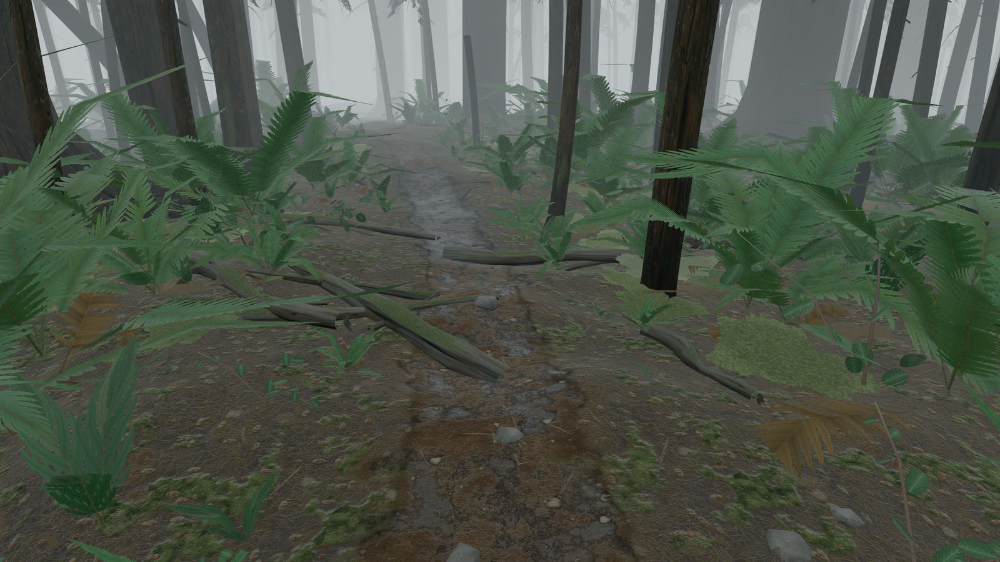

# Foggy Pine Trail

A first-person walk down a narrow dirt trail through dense Pacific Northwest pine
forest at 6am, in heavy fog.

**Every texture, mesh, material and sound in this project is generated
procedurally in code.** There are no downloaded images, no HDRIs, no model files
and no audio samples. Nothing under `src/` is a binary — the forest is built
from noise functions, swept geometry and a Web Audio graph at runtime, on your
GPU, in about half a second. The only binaries in the repository are the
screenshots on this page, and they are output, not input.





*Eight seconds of the 35-second capture, walking north. Recorded by driving the
real walker with real input — see `tools/reel.mjs` below.*

---

## Run it

```bash
npm install
npm run dev
```

Then open <http://localhost:3100>.

Click the canvas to capture the mouse. **WASD** to walk, **mouse** to look,
**Space** to jump, **Escape** to release the pointer. You can leave the trail and
wander roughly 30 m into the stand before it turns you back.

Audio starts on the first click. It is worth turning on — the wind through the
needles is the layer with the most work in it, and the forest is deliberately
sparse, so give it a minute before deciding it is too quiet.

Requires a desktop with a mouse and keyboard, and a discrete GPU is
recommended. Measured at 60 fps on an RTX 4060 at 1600×900.

---

## What it is made of

Eight systems, built and reviewed in order. Each was judged against real
photographs of Pacific Northwest forest by an independent critic that saw only
the rendered output and never the source.

| System | What it does |
|---|---|
| **Trail** | Catmull-Rom curve with a bucketed distance field. Every other system queries it: the ground cuts its trough from it, trees refuse to stand on it, ferns crowd its margin and stop. |
| **Ground** | Analytic heightfield — macro relief, pit-and-mound hummocks, a worn tread with ruts and root swells. Two GPU-baked surfaces blended by a vertex weight. |
| **Trees** | ~420 Doug-fir, hemlock and cedar with tapered, swept boles, root flare, dead branch stubs, standing snags, hung-up leaners, downed logs and root plates. |
| **Fog** | A global patch of three's fog shader chunks: true path length, a camera-normalised exponential-height integral, sky-derived colour, aerial-perspective closeout and 3D density noise. |
| **Undergrowth** | ~2,000 instanced sword fern, salal, deer fern and Oregon grape, plus moss collars, needle drift and mushroom troops on merged per-tile buffers. |
| **Lighting** | A procedurally generated fog dome through `PMREMGenerator`. No directional light and no shadow maps anywhere. |
| **Particles** | 585 points in a single draw call — drifting pollen and slowly falling needles, all motion in the vertex shader. |
| **Post** | Half-float HDR target with depth, near-field defocus, a saturation-keyed shadow lift and an AgX chroma restore. |

---

## Notes on the interesting parts

### The fog is the whole project

Dense fog is what makes this read as a photograph, and almost every other
decision follows from it.

The density is not a taste value. Meteorological visibility is defined as the
range at which a black object reaches 2% contrast, which for this fog function
means `(d·k)² = ln 50`, so `k = 1.98 / d_vis`. At 36 m visibility that is
0.0550, and it is written that way in `env.ts` so the number can be checked
rather than argued about.

Three things about the implementation matter:

**It patches `THREE.ShaderChunk` globally** rather than per material. Every
material already includes the fog chunks, so patching them means the ground, the
bark, the ferns and the particles are fogged by literally the same text — not by
four implementations that agree today.

**It uses path length, not planar depth.** Three's stock chunk measures
`-mvPosition.z`, the distance to the camera *plane*, which diverges without
limit toward the frame edges and puts straight terminators across large ground
planes.

**It mixes in scene radiance, not display values.** Three includes
`fog_fragment` after tone mapping and the sRGB encode, so mixing there is a
category error that understates the haze by roughly five times in shadow. The
mix happens in `tonemapping_fragment`, the last point at which the fragment is
still light.

The result is that the air converges on the same radiance as the sky dome — 193
against 193.1–193.8 measured — so distant geometry lands exactly on the sky and
disappears instead of keeping a residual outline.



### There is no sun

Not a weak sun: none. The cloud deck is thick and the fog under it is thicker, so
by the time light reaches the floor it arrives from the entire upper hemisphere
at once. Any directional light with a shadow map in this scene would be wrong,
and the standard instinct to "add a weak sun for shape" is exactly what makes a
fog render look like a sunny one with the fog slider up.

The consequence is that **ambient occlusion is the exposure control.** A
dielectric under a bright fog dome returns about 4% of the sky whatever its
albedo, so lowering diffuse alone hits a floor — at one point a 10× albedo cut on
a prop moved it visually not at all. This surprises people and it caused the
single largest bug in the project's history.



### Everything is measured

Screenshots lie about exposure, and a fog scene is the worst possible subject for
judging by eye. So the tools in `tools/` read numbers out of the running page:
luma histograms against real-photograph references, saturation by depth band,
per-term differenced pairs, trail cross-sections in centimetres, spectral
measurements of the audio.

Every visual term has a dev switch that substitutes a *constant* into the same
GLSL, so the compiled program is structurally identical either way and a measured
difference cannot be an artefact of having compiled a different shader:

```
?fog=noheight,nopatch   ?ug=noocc      ?post=nolift,nograin
?p=nodust               ?nohdr         ?fog=off
```

This exists because the project's defining failure mode turned out to be code
that typechecks, reads correctly, and changes zero pixels. Eight separate
instances were found this way — roughness values with no environment map to
reflect, a polish term firing on 2.4% of the surface, an unreachable lean cap, a
sky-view term saturating to a constant. **A term that cannot be switched off
cannot be proved to be on.**

---

## A few bugs worth recording

Kept because each one was invisible in review and found by measurement or by
walking around.

**The ground was inside-out.** The first build rendered a flat grey frame. The
bake was fine and the shader patch was landing; the grid's triangle winding was
inverted, so every face was back-facing and culled. Proved by swapping in a probe
material and measuring coverage per face side: 3.2% front-facing against 84.6%
back-facing on identical geometry. The vertex normals were analytic and therefore
correct throughout, which is why it presented as a lighting fault.

**The trees were inside-out too, and so were their ancestors.** Every lateral
quad in the bole sweep was wound opposite to its own vertex normal, so the
`FrontSide` wood material culled the near wall of each trunk and drew the inside
of the far one — 88% of triangles inverted across all 31 tree tiles. A user
walking around a trunk reported "I can see inside trees, they feel like thin
paper", which is exactly what an inverted cylinder looks like: the curvature
gradient runs backwards and reads concave. The prior project this geometry
descends from had the identical bug and documented both the symptom and the
normal-audit that finds it; this one inherited the fault without the fix.

**The undergrowth was occluded twice.** Two systems each applied the project's
own "AO is the exposure control" rule for the same shadowing, and the product
came out around 0.30 — a stop and a quarter under. The near ferns rendered at
luma 8–22 where real understory measures 71–97.

**Three ships AgX bare.** Only the base transform, whose inset walks primaries
toward the achromatic axis so bright colour has somewhere to roll off — and
nothing walks them back. Blender, which three's implementation is a port of,
never displays AgX without a look on top. Adding the chroma restore where Blender
puts it took fern saturation from 0.104 to 0.169 with luma unchanged.

**A shadow lift divided by near-zero.** Its achromatic gate divided by the
pixel's own brightness, and on bark at display value 31 that denominator is mostly
noise — so each pixel independently won either a 2.24× lift or none, laying ±12
code values of chromatic speckle over the largest surface in every frame. It read
as the whole image being *blurry*; measured, the bark carried seven times more
high-frequency energy than the bypass path. Noise, not blur.

---

## Tools

All capture attaches to an already-running dev server and tears down on every
exit path, including throws and signals.

```bash
npm run dev                       # required first, port 3100

node tools/shoot.mjs <tag>        # six trail stops + down/up framings
node tools/reel.mjs               # deterministic 35 s walk, encodes with ffmpeg
node tools/hero.mjs <tag> --views "0.78:0@a; 0.6:0@b"
node tools/px.mjs "<expression>"  # evaluate in the page, print JSON
node tools/confine.mjs            # assert the walker cannot leave the world
node tools/audio.mjs              # 105 offline DSP measurements
node tools/audiolive.mjs          # prove the audio graph passes signal
```

`tools/reel.mjs` drives the real walker with real input rather than
interpolating a camera, because the gait bob, the weight-transfer roll and the
handheld drift only exist if the walker is actually simulated — and they are most
of what makes the walk read as a person.

---

## Stack

Next.js 16 (App Router) · React 19 · Three.js 0.185 · React Three Fiber 9 ·
TypeScript · Tailwind 4 · Playwright for capture.

## Credits

Architecture and technique follow two earlier procedural-scene projects,
`jungle-trail` and `night-street`. The GPU texture baker, the trail distance
field, the tile-bucketed instancing and the linear-HDR post ordering are all
adapted from them.

## Licence

MIT
